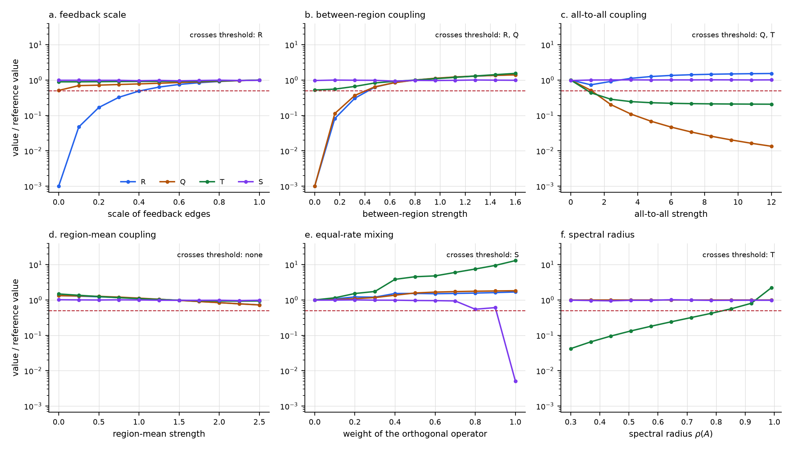

## Abstract

Indices of conscious state each track one property of brain dynamics, yet the states they must sort differ along several: under ketamine people are unresponsive and dream, under xenon the cortex answers a magnetic pulse with a large stereotyped wave, and under propofol with a small local one. We state a minimal conscious regime as the conjunction of four dynamical invariants, between-region recurrence ($R$), perturbational repertoire ($Q$), endogenous temporal depth ($T$) and stable macrostructure ($S$), and give each an estimator on a fitted linear-Gaussian vector autoregression. $R$ is zero whenever no causal path returns to its region of origin. $T$ sums lagged mutual information given the input, so a fast network that buffers a slow stimulus scores near zero. $S$ is the test-retest stability of a dynamically independent macro, and for this model class those macros are the invariant subspaces of the transposed operator. Four families of modular networks each fail one invariant and pass the other three for every pass threshold between 0.076 and 0.645 of a reference network, so no invariant follows from the other three. Across 1000 random networks, between 5.5% and 50.1% of the networks that pass three invariants fail the fourth, and none of six control parameters takes $Q$ below threshold on its own. A conjunction pays for its specificity in sensitivity: four independent invariants each need a margin of 1.94 measurement standard deviations to reach 90% joint sensitivity, against 1.28 for one, and four tests at the 94.7% sensitivity that the perturbational complexity index reached in minimally conscious patients would jointly detect 80.6%. When transition times are noisy and nothing leads anything, the first of four invariants to fail precedes the change in report with probability 0.8, so timing tests need order-statistic nulls. From these results we specify a crossover experiment with propofol, ketamine and dexmedetomidine: its endpoints, its sample size, which holds at 40 participants only while at most 4% of experience labels are wrong, and the outcomes that would refute the regime.

## 1. One index per state, several properties per state

The perturbational complexity index (PCI) measures how complex the cortical response to a transcranial magnetic pulse is, after binarizing the response against baseline and compressing it [@casali2013]. Validated on a benchmark of 150 healthy and brain-injured subjects who could report, its cutoff separated conscious from unconscious conditions without error, and it detected 94.7% of 38 patients in a minimally conscious state, while 9 of 43 patients in a vegetative state scored above it [@casarotto2016]. Anaesthetics do not all fail in one way. In 18 volunteers, propofol produced a low-amplitude slow wave that stayed near the stimulated site, xenon a high-amplitude slow wave that spread over the cortex in a stereotyped pattern, and ketamine a complex, wake-like response; after propofol and xenon participants reported nothing, after ketamine long, vivid dreams [@sarasso2015]. The loss of propagation under propofol repeats what non-rapid-eye-movement sleep does to the same probe [@massimini2005].

Behavioural unresponsiveness is a poor label. Of 93 interviews conducted during target-controlled infusion of dexmedetomidine or propofol, 84% contained experiences from the unresponsive period (90% under dexmedetomidine, 74% under propofol), most of them internally generated [@radek2018]. Across 157 studies and 87,866 participants, dream recall after anaesthesia ran from 40% to 80% in experimental settings and from 3% to 8% in large clinical trials, and recall was unrelated to intraoperative awareness [@sikka2026]. In sleep, awakenings with and without reported experience differ in posterior low-frequency activity, and during non-rapid-eye-movement sleep that difference predicts the report in real time [@siclari2017]. The labels a measure of conscious state must match come from report after awakening.

Newer indices each read one property. Distance from avalanche criticality and from the edge of chaos in resting electroencephalography (EEG) predicts individual PCI under propofol, xenon and ketamine [@maschke2024], and has been proposed as the organizing variable for consciousness [@algom2026]. Dynamical independence, a measure of how far a macroscopic variable evolves on its own, rises but fluctuates under propofol and xenon and falls with partial preservation of structure under ketamine [@milinkovic2026]. A whole-brain model shows perturbational complexity only in a regime of high functional fluidity that can be read from spontaneous activity [@breyton2025]. Conceptual work has argued that global states are points in a space of several dimensions, ill described by a single level [@bayne2016; @birch2020], and that tests for consciousness need a classification and a validation strategy of their own [@bayne2024].

Following that argument, we state a regime with four constitutive invariants. A system is in the minimal conscious regime when, at once, causal influence returns between its regions ($R$), its responses to perturbation are widespread and differ by site ($Q$), its own dynamics hold information over time ($T$), and it has a macroscopic organization that persists ($S$). Criticality, rhythms, travelling waves, thalamic drive, dendritic coupling, metabolism, glia and breathing enter as controllers, variables that move a system across the boundary of the regime by moving one or more invariants. Self-related capacities (bodily self, perspective, metacognition) form a separate profile. The regime is a hypothesis of necessity for each invariant and joint sufficiency for the four; it is testable only if each invariant has an estimator, if no invariant is implied by the others, and if the cost of testing a conjunction is known. This paper supplies the three for a stated model class and turns them into an experiment.

## 2. Invariants, controllers and what the regime leaves out

### 2.1 The four invariants

Between-region recurrence ($R$) is the return of causal influence to a region through other regions. Recurrent processing has long been proposed as the difference between conscious and unconscious processing of a stimulus [@lamme2006]. In mice, three anaesthetics decouple the apical dendrites of layer 5 pyramidal neurons, where much cortico-cortical feedback arrives, from their cell bodies [@suzuki2020; @larkum2013], a mechanism that would block feedback while sparing feedforward signalling [@suzuki2020; @aru2020]. In macaques, consciousness tracks deep-layer neurons that feed back to superficial layers under the drive of the central lateral thalamus, across anaesthetics and sleep [@redinbaugh2020].

Perturbational repertoire ($Q$) is the variety of responses a system gives to perturbations at different sites, when those responses spread. It is the property PCI estimates [@casali2013; @comolatti2019] and the combination of integration and differentiation that motivated it [@tononi1998], which a review of neural correlates judged the more promising route to a quantitative index after other candidate markers failed [@koch2016]. A local response fails it, as under propofol, and so does a global response that is the same whatever the site, as under xenon [@sarasso2015]. In rats, the repertoire of intrinsic brain states falls by 20% at an anaesthetic dose of propofol [@hudetz2015].

Endogenous temporal depth ($T$) is the information the system's own dynamics hold from one moment to later ones. Propofol-induced loss of consciousness reduces long-range temporal correlations in frontothalamic regions [@tagliazucchi2016]; working memory in monkey prefrontal cortex is carried by brief bursts of gamma and beta activity [@lundqvist2016; @lundqvist2024]; time-irreversibility of neural dynamics has been proposed as a signature of conscious states [@nartallo2026]. The qualifier "endogenous" excludes memory that sits in a slowly varying input: a fast network driven by a slow stimulus has temporally correlated activity and holds nothing itself.

Stable macrostructure ($S$) is a macroscopic description that evolves on its own and stays the same across time. A macroscopic variable is dynamically independent when the microscopic past adds nothing to its own past in predicting its future [@barnett2023], a notion related to information-theoretic measures of causal emergence [@rosas2020]. Under propofol and xenon, the dynamically independent macros found in source-reconstructed EEG are more emergent and more variable over time; under ketamine emergence is lower and macroscopic structure is partly preserved, and the authors caution against reading the amount of emergence as a level of consciousness [@milinkovic2026]. $S$ is defined on the stability of the macro, the property that this result separates from its amount.

### 2.2 Controllers

A controller is a variable that changes whether a system is conscious only by changing one or more invariants. Criticality is the main candidate. Neuronal avalanches follow power laws [@beggs2003], in every vigilance state with state-dependent shape, consistent with a brain that operates slightly below the critical point [@priesemann2013]. Power laws also arise away from criticality [@touboul2017], the experimental record is contradictory [@wilting2019], and the distance to criticality has been proposed as the useful quantity [@obyrne2022]. Departure from criticality accompanies propofol unconsciousness [@tagliazucchi2016; @maschke2024]. In the model class of section 3, distance from the critical point $\rho(A) = 1$ is set by the spectral radius, and the spectral radius enters only $T$; that is the formal sense in which criticality is a controller here.

Rhythms and waves coordinate communication between areas [@buzsaki2004; @fries2015; @muller2018; @cruddas2026]. Thalamic core and matrix cells have been assigned distinct roles in conscious state and content [@whyte2024]; stimulation of the central thalamus reverses the cortical signatures of propofol in macaques [@bastos2021] and the structure-bound dynamics induced by propofol, sevoflurane and ketamine, while stimulation of the ventral lateral thalamus does not [@luppi2024]; propofol disrupts the functional core-matrix architecture of the human thalamus [@huang2024]. Metabolic and glial variables are candidate controllers as well. Isoflurane and sevoflurane disrupt complex I-linked respiration and reverse the ATP synthase at anaesthetic doses in Drosophila [@rodriguez2025]; brain mitochondria have been reviewed as drivers of cognition and behaviour [@sandi2026]; astrocytic Kir4.1 in the paraventricular thalamus modulates recovery from sevoflurane [@zhao2024], and astrocyte morphology regulates state transitions under inhaled anaesthesia [@zhou2025]. Breathing entrains activity across the brain and modulates faster oscillations [@tort2025]. None of these is constitutive under the regime hypothesis; each is a route by which the invariants are reached.

### 2.3 Self-related capacities

Body ownership and self-location rely on partly distinct substrates [@blanke2012; @serino2013]; metacognition builds self-directed estimates of performance from transformations of uncertainty [@fleming2026] and has been proposed as the basis of conscious awareness by higher-order theories [@brown2019]. These capacities and the conscious state come apart. Metacognitive monitoring is above chance only from about 3.5 years [@gardier2024], while the evidence favours consciousness in newborns [@bayne2023; @passosferreira2024]; ketamine dreams are experiences with altered self-related content [@sarasso2015]; blindsight dissociates visual processing from reported awareness [@derrien2022]. The regime concerns being conscious at all; the self-related profile is a separate set of dimensions.

### 2.4 Relation to theories

Global workspace theory locates consciousness in the ignition and broadcast of content [@dehaene2011; @mashour2020]; integrated information theory in the causal structure of a system [@tononi1998]; integrative proposals combine elements across theories and scales [@storm2024; @seth2022]. A preregistered adversarial test challenged key tenets of the first two [@cogitate2025]. The regime is a hypothesis about the global state, silent on content, and its four invariants are defined on dynamics, so it is neutral about substrate as stated. Whether a living substrate is required [@seth2025] needs a definition of what "living" adds [@kleiner2026], for instance the metabolic grounding of membrane potential [@lane2026]; the estimators below do not settle that question.

## 3. Estimators on a linear-Gaussian model

### 3.1 Model and normalization

Let $Z_t \in \mathbb{R}^N$ be the source activity of $N$ units grouped into $M$ regions $X_1, \dots, X_M$, and let

$$Z_{t+1} = A Z_t + B u_t + \eta_t, \qquad \eta_t \sim \mathcal{N}(0, \Sigma_\eta),$$

with $\Sigma_\eta$ nonsingular ($\Sigma_\eta = I$ in the simulations) and $u_t$ an exogenous input independent of the innovations $\eta_t$. In practice $A$ is fitted to source-reconstructed EEG, magnetoencephalography or intracranial recordings by least squares [@lutkepohl2005]. Write $P_X$ for the projection onto the units of region $X$, $X(i)$ for the region of unit $i$, $A_{\rm in}$ for the within-region part of $A$ (its block-diagonal) and $\rho(A)$ for its spectral radius. Three invariants are computed on the gain-normalized operator $\bar A = \rho_{\rm ref} A / \rho(A)$ with $\rho_{\rm ref} = 0.9$, and $T$ on $A$ itself. The normalization assigns the one parameter that sets every timescale, the distance $1 - \rho(A)$ from the critical point, to $T$, and lets $R$, $Q$ and $S$ measure organization at a fixed gain.

### 3.2 Between-region recurrence

For a unit impulse $e_i$, the response $\bar A^\tau e_i$ splits into what stays in the region of origin, what leaves it, and what returns to it after leaving. The returned part is $P_{X(i)}(\bar A^\tau - \bar A_{\rm in}^\tau) e_i$, because $\bar A_{\rm in}^\tau e_i$ collects every path that never leaves $X(i)$. Define

$$R = \frac{\sum_{i=1}^{N} \sum_{\tau \ge 1} \lVert P_{X(i)} (\bar A^\tau - \bar A_{\rm in}^\tau) e_i \rVert^2}{\sum_{i=1}^{N} \sum_{\tau \ge 1} \lVert (I - P_{X(i)}) \bar A^\tau e_i \rVert^2}.$$

**Proposition 1.** If the region graph of $A$ (an edge from $X$ to $Y \neq X$ when some $A_{yx} \neq 0$ with $x \in X$, $y \in Y$) is acyclic, then $R = 0$. If $A$ is entrywise nonnegative and some directed path of the unit graph leaves a region and returns to it, then $R > 0$.

*Proof.* $(\bar A^\tau)_{ji}$ is a sum over paths of length $\tau$ from $i$ to $j$. When the region graph is acyclic, a path that leaves $X(i)$ cannot re-enter it, so for $j \in X(i)$ the sum reduces to paths inside $X(i)$, which is $(\bar A_{\rm in}^\tau)_{ji}$, and the numerator vanishes. With nonnegative weights every path contributes a nonnegative term, so a returning path of length $\tau$ from $i$ to $j \in X(i)$ makes $(\bar A^\tau - \bar A_{\rm in}^\tau)_{ji} > 0$. $\square$

With signed weights, cancellation can in principle hide a cycle, but it requires a coincidence of weights that a fitted operator has with probability zero.

### 3.3 Perturbational repertoire

Pulse each region with $x_0^{(r)} = \mathbf{1}_{X_r} / \sqrt{|X_r|}$ and record $y_t^{(r)} = \bar A^t x_0^{(r)}$ for $t = 1, \dots, H$ with $H = 60$ (at $\rho_{\rm ref} = 0.9$ the response has decayed by a factor below $2 \times 10^{-3}$). Integration is the share of response energy outside the pulsed region and differentiation is the dissimilarity of the responses to different regions, each pair compared on the units outside both pulsed regions:

$$I_Q = \frac{1}{M} \sum_{r} \frac{\sum_t \lVert (I - P_{X_r}) y_t^{(r)} \rVert^2}{\sum_t \lVert y_t^{(r)} \rVert^2}, \qquad D_Q = 1 - \binom{M}{2}^{-1} \sum_{r < s} \lvert \cos_{rs} \rvert, \qquad Q = I_Q D_Q,$$

where $\cos_{rs}$ is the cosine between the stacked responses $(y_1^{(r)}, \dots, y_H^{(r)})$ and $(y_1^{(s)}, \dots, y_H^{(s)})$ restricted to units outside $X_r \cup X_s$. $Q$ is zero when no response leaves its region ($I_Q = 0$) and when the responses to all sites are proportional away from the pulsed regions ($D_Q = 0$), the propofol and xenon patterns of the same probe [@sarasso2015]. PCI estimates the same property from data by binarizing the response against baseline and compressing it with Lempel–Ziv complexity [@casali2013; @lempel1976], or by counting state transitions in its principal components [@comolatti2019]; $Q$ is a threshold-free counterpart defined on the operator.

### 3.4 Endogenous temporal depth

Define $T$ as lagged mutual information summed over lags, conditioned on the input path and expressed per unit:

$$T = \frac{1}{N} \sum_{\tau \ge 1} I(Z_t; Z_{t+\tau} \mid u) = \frac{1}{2N} \sum_{\tau \ge 1} \log \frac{\det \Sigma}{\det(\Sigma - A^\tau \Sigma A^{\tau\top})}, \qquad \Sigma = A \Sigma A^\top + \Sigma_\eta.$$

**Proposition 2.** For an exogenous input, $T$ depends on $A$ alone.

*Proof.* Given the whole input path, $Z_t$ equals a deterministic function of the path plus $\sum_{k \ge 0} A^k \eta_{t-1-k}$, the stationary autonomous process. Conditional mutual information between $Z_t$ and $Z_{t+\tau}$ equals the mutual information of the autonomous parts, whose covariance is $\Sigma$ and lag covariance $A^\tau \Sigma$; the Gaussian formula gives the expression above [@cover2006]. $\square$

The sum diverges as $\rho(A) \to 1$, so the distance from the critical point controls $T$ directly. Without conditioning, a fast network that relays a slow input accumulates lagged information from the input's own autocorrelation (section 4.1).

### 3.5 Stable macrostructure

A linear macro is $Y_t = L Z_t$ with $L \in \mathbb{R}^{n \times N}$ of full row rank. Its dynamical dependence is the transfer entropy from $Z$ to $Y$ given the past of $Y$ [@barnett2023], which for Gaussian processes is a Granger-causality statistic [@barnett2009].

**Proposition 3.** For $Z_{t+1} = A Z_t + \eta_t$ with nonsingular innovation covariance, $Y = LZ$ has zero dynamical dependence if and only if $L A = \tilde A L$ for some $\tilde A \in \mathbb{R}^{n \times n}$, that is, if and only if the row space of $L$ is invariant under $A^\top$.

*Proof.* Zero transfer entropy means $\mathbb{E}[Y_{t+1} \mid Z_t, Z_{t-1}, \dots] = \mathbb{E}[Y_{t+1} \mid Y_t, Y_{t-1}, \dots]$. The left side is $L A Z_t$. The right side is a linear function $\sum_{k \ge 0} C_k L Z_{t-k}$. The innovation $\eta_{t-1}$ enters $Z_t$ with coefficient $I$ and none of $Z_{t-1}, Z_{t-2}, \dots$, so equating its coefficients gives $L A = C_0 L$, because $\eta_{t-1}$ has nonsingular covariance. Conversely, $L A = \tilde A L$ gives $Y_{t+1} = \tilde A Y_t + L \eta_t$, an autonomous process. $\square$

For diagonalizable $A$, the dynamically independent macros of the model are therefore the spans of left eigenvectors (real invariant subspaces, with complex pairs taken together). We take the macro of dimension $n$ spanned by the $n$ slowest modes, the coarsest description in time, and measure whether it persists. From $K = 6$ independent windows of 4000 samples, fit $\hat A_k$ to each window, let $U_k(n)$ be an orthonormal basis of its slowest $n$-mode left-invariant subspace (dimension $d = n$, or $n + 1$ when $n$ would split a conjugate pair), and define

$$o(n) = \binom{K}{2}^{-1} \sum_{k < l} \frac{\lVert U_k(n)^\top U_l(n) \rVert_F^2}{d}, \qquad S = \max_{1 \le n \le 12} \frac{o(n) - \bar d / N}{1 - \bar d / N},$$

where the correction makes the overlap of random subspaces zero. Rescaling an operator leaves its eigenvectors unchanged, so with data the windows are used as recorded; the simulations draw them from $\bar A$. Scanning $n$ makes $S$ a statement about the existence of a persistent macro at some scale. Its population counterpart is governed by the spectral gap: an invariant subspace moves under a perturbation of size $\varepsilon$ by an angle of order $\varepsilon$ divided by the separation of its spectrum from the rest, for symmetric operators [@davis1970] and, with a separation defined for nonsymmetric ones, in general [@stewart1973]. An operator whose modes all decay at one rate has no separated macro at any dimension.

### 3.6 Thresholds

An invariant passes when its value is at least half of its value in a reference network. The fraction is a convention, and section 4.2 reports the interval of fractions over which the conclusions hold.

## 4. Results in the model class

All networks have $N = 64$ units in $M = 8$ regions of 8. The reference network has Gaussian within-region coupling (standard deviation $0.5/\sqrt{8}$), sparse between-region edges (density 0.25, standard deviation 0.2), and a region-mean coupling of 0.7 that gives each region a slow collective mode; the whole operator is then rescaled to spectral radius 0.95. Its invariants are $R = 0.067$, $Q = 0.478$ ($I_Q = 0.628$, $D_Q = 0.760$), $T = 0.539$ nats per unit and $S = 0.950$, the last attained by a one-dimensional macro. Every number below comes from one recorded execution of the simulation, which runs 20 internal checks.

### 4.1 The estimators behave as derived

In 40 random modular networks with feedback edges removed, $R$ was exactly zero in floating point, as Proposition 1 requires; with feedback scaled to 0.3 of its reference strength the smallest $R$ was 0.0106, and in 40 nonnegative networks with sparse between-region edges the smallest was 0.0228 (Figure 1a).

For the macro check we simulated 200,000 steps of the normalized reference network and compared macros spanned by the slowest 1, 4 and 8 left eigenvectors with random macros of the same dimension. The invariance residual $\lVert LA - \tilde A L \rVert / \lVert LA \rVert$ was at most $4.6 \times 10^{-15}$ for the eigen-macros and above 0.9 for every random macro. The estimated transfer entropy from the micro state to the eigen-macros was at most 0.92 of its sampling bias under the null (the likelihood-ratio statistic $2T \cdot \mathrm{TE}$ is asymptotically $\chi^2$ with $N d$ degrees of freedom), and for random macros it exceeded that bias by a factor of at least 1271 (Figure 1b).

For temporal depth, a network rescaled to spectral radius 0.3 and driven through random input weights by four autoregressive inputs has $T = 0.0226$ nats per unit whatever the input. Its unconditional lagged information rises from 0.0378 for white input to 2.57 for input autocorrelation 0.99, above the reference network's $T$ of 0.539 (Figure 1c). A measure of temporal depth that does not condition on the input would rank this relay above the reference network.

![Estimator checks. (a) $R$ in 40 networks with feedback removed (all exactly zero, drawn at the floor) and in the same networks with feedback scaled by 0.3. (b) Transfer entropy from the micro state to macros spanned by the slowest left eigenvectors and to random macros of the same dimension; the black line is the expected estimator bias under zero dependence. (c) A fast network relaying a slow input: lagged information without conditioning grows with the input's autocorrelation, $T$ conditioned on the input stays at the network's own value.](../simulation/output/figures/estimators.png)

### 4.2 Each invariant can fail alone

Four families of networks, derived from the reference, each fail one invariant (Table 1, Figure 2a). Removing feedback edges and doubling forward ones makes the region graph acyclic, so $R = 0$, while $Q$ keeps 0.645 of its reference value. Adding an all-to-all coupling of strength $8/N$ per entry and raising the spectral radius to 0.995 makes the response to every site the same global mode ($D_Q = 0.016$), so $Q$ falls to 0.028 of reference while $T$ rises. Lowering the spectral radius to 0.3 leaves $R$ and $Q$ unchanged by construction and $S$ unchanged up to estimation noise, and takes $T$ to 0.042 of reference. A scaled random orthogonal operator, whose modes all decay at the same rate, has $S$ at 0.076 of reference while its $R$, $Q$ and $T$ exceed the reference values.

The pattern "fails its target invariant and only that one" holds for every pass threshold between 0.076 and 0.645 of the reference values: below 0.076 the equal-rate network passes $S$, above 0.645 the network without feedback fails $Q$ as well. At the threshold of one half it held for 19 of 20 random seeds in the feedback-removed family (the exception fell to 0.488 of reference on $Q$) and for all 20 seeds in the other three. No invariant follows from the other three.

| network | $R$ | $Q$ | $T$ (nats/unit) | $S$ | fails |
|:--|--:|--:|--:|--:|:--|
| reference | 0.067 | 0.478 | 0.539 | 0.950 | none |
| feedback removed | 0 | 0.308 | 1.050 | 0.927 | $R$ |
| global mode | 0.097 | 0.013 | 1.263 | 0.959 | $Q$ |
| fast decay | 0.067 | 0.478 | 0.023 | 0.946 | $T$ |
| equal rates | 0.114 | 0.871 | 6.986 | 0.072 | $S$ |

: Invariants of the reference network and of four families that each fail one invariant.

### 4.3 How much each invariant adds across an ensemble

We drew 1000 networks with independent random parameters: within-region coupling scale uniform on 0.3 to 1.5, between-region strength on 0 to 1.6 and density on 0.05 to 0.5, region-mean coupling on 0 to 2.5, all-to-all coupling zero with probability one half and otherwise log-uniform on 0.5 to 12, feedback scale zero with probability 0.2 and otherwise uniform on 0 to 1, weight of a random orthogonal operator zero with probability one half and otherwise uniform on 0 to 1, and spectral radius uniform on 0.3 to 0.99. Of these, 222 passed all four invariants at the half-reference thresholds (Figure 2c). The largest rank correlation between two invariants was 0.641 ($Q$ with $T$), and the other three invariants explained at most 61.9% of the rank variance of any one in a linear regression (the maximum, again for $Q$; 28.3% for $S$ and 29.8% for $R$).

The question a measurement design must answer is how often the fourth invariant fails when three pass. Among networks passing the other three, $R$ failed in 14.9% (of 261), $Q$ in 5.5% (of 235), $T$ in 50.1% (of 445) and $S$ in 17.2% (of 268). Among networks that pass $Q$, 64.1% fail at least one other invariant (Figure 2d). These percentages depend on the ensemble's parameter distribution and show only that each invariant removes networks the other three admit.

![Dissociation atlas and ensemble. (a) The four families, values relative to the reference network on a logarithmic axis; the dashed line is the threshold of one half and the shaded band the interval of thresholds (0.076 to 0.645) over which each family fails its target invariant alone. (b) Spearman correlations of the four invariants across 1000 random networks. (c) Pass patterns, letters for passed invariants and dashes for failed ones; blue bars fail one invariant. (d) $Q$ against $S$ with the thresholds; green points pass all four invariants.](../simulation/output/figures/atlas.png)

### 4.4 Controllers move one invariant or two

Six parameters of the reference network were swept one at a time over the ranges of the ensemble (Figure 3). Scaling the feedback edges takes $R$ across its threshold and no other invariant ($Q$ stays at or above 0.508 of reference). Mixing in a random orthogonal operator takes $S$ across alone, and only near full weight. The spectral radius takes $T$ across alone, and leaves $R$ and $Q$ unchanged to rounding error, as the normalization requires. Between-region coupling takes $R$ and $Q$ across together, all-to-all coupling takes $Q$ and $T$ together, and region-mean coupling keeps $R$, $Q$ and $T$ between 0.72 and 1.48 of their reference values without taking any across. No parameter takes $Q$ across on its own: weakening between-region coupling takes $R$ with it and strengthening the global mode takes $T$ with it. The ensemble agrees, with 13 networks failing $Q$ alone against 39, 46 and 223 failing $R$, $S$ and $T$ alone.

For experiments this means that a manipulation of one controller, an anaesthetic or a stimulation, should be expected to move several invariants, so an observed change in consciousness cannot be attributed to one invariant without measuring all four. States in which only $Q$ fails are the rarest in the model class. The necessity test for $Q$ will have the fewest epochs.

## 5. The statistics of a conjunctive test

### 5.1 Sensitivity and margins

Let the measurement error of invariant $k$ be Gaussian with standard deviation $\sigma_k$, and let a conscious state lie $d_k \sigma_k$ above each threshold. With independent errors the conjunction detects it with probability $\prod_k \Phi(d_k)$, so 90% joint sensitivity with equal margins needs $d = \Phi^{-1}(0.9^{1/4}) = 1.94$ standard deviations per invariant, against 1.28 for a single test. With exchangeable error correlation $r$ the sensitivity is

$$\int_{-\infty}^{\infty} \phi(z) \, \Phi\!\left( \frac{d + \sqrt{r} \, z}{\sqrt{1 - r}} \right)^{4} dz$$

[@dunnett1955], and the required margin falls to 1.91 at $r = 0.25$, 1.84 at $r = 0.5$ and 1.57 at $r = 0.9$ (Figure 4a); a Monte Carlo estimate with 400,000 draws at $r = 0.5$ gave 0.9002 for a nominal 0.9. Correlated errors make the conjunction cheaper, because the four tests then fail together, and they make it less informative for the same reason.

A benchmark anchors these numbers. PCI detected 94.7% of 38 minimally conscious patients [@casarotto2016], 36 of 38, with exact 95% interval 82.3% to 99.4% [@clopper1934]. Four independent tests with that sensitivity would jointly detect 80.6% of such patients, and 84.9% with error correlation 0.5. A conjunctive regime is affordable only with estimators of smaller error than any single index now validated, or with states that lie further from threshold.

### 5.2 Labels, sample size and clustering

Experience labels from interviews are themselves noisy: a report can be confabulated, and an experience can go unreported. If a fraction $f$ of epochs labelled conscious are unconscious, a test with sensitivity 0.9 and specificity 0.9 shows an observed sensitivity of $(1 - f) \cdot 0.9 + f \cdot 0.1$, which is 0.86 at $f = 0.05$ and 0.82 at $f = 0.1$; the bias can be corrected when $f$ is known [@rogan1978].

Take as primary endpoint that the one-sided 95% Clopper–Pearson lower bound of sensitivity exceeds 0.80, with 80% power. With exact binomial calculations the number of independent conscious epochs required is 94 with clean labels, 112, 135, 170 and 210 at label-noise rates of 1%, 2%, 3% and 4%, 271 at 5% and 2476 at 10% (Figure 4b). A label-noise rate of 5% multiplies the required sample by 2.88. Epochs cluster within participants: with 10 conscious epochs per participant and intraclass correlation 0.1, the design effect $1 + (m - 1)\rho_{\rm ICC}$ is 1.9 [@kish1965; @killip2004], and the participants needed rise from 18 with clean labels to 52 at 5% label noise. A confirmatory cohort of 40 participants meets the endpoint up to a label-noise rate of 4%.

### 5.3 Necessity and simpler models

The claim that invariant $i$ is necessary predicts few reports of experience from epochs in which only $i$ fails. A within-participant test pairs such an epoch with an epoch in which all four invariants pass and compares the reports with McNemar's exact test [@mcnemar1947], one-sided at $\alpha = 0.05/4$ to cover the four invariants. Let the report rate be 0.9 in all-pass epochs and 0.05 in epochs that truly fail an invariant, and let a fraction $c$ of epochs classified as single failures be misclassified all-pass epochs. The pairs needed for 80% power are 9 at $c = 0$, 14 at $c = 0.25$, 26 at $c = 0.5$ and 75 at $c = 0.75$ (Figure 4c). Few pairs suffice when classification is clean; the scarce resource is the single-failure epochs themselves, which section 4.4 suggests will be rare for $Q$. The same test compares the conjunction with a single-index model such as $Q$ alone on the epochs where their predictions disagree.

### 5.4 Transition timing

The order of events at induction and emergence is a test of whether the regime precedes experience or follows it. For a conjunction, the regime is lost when its first invariant fails and regained when its last invariant recovers, so necessity predicts that the first failure precedes the loss of reported experience and that the last recovery precedes its return. A requirement that all four invariants fail before experience is lost is stronger than necessity implies.

Estimated transition times are noisy. If the four invariant transitions and the report transition occur at the same true time with independent, identically distributed errors, the earliest of five exchangeable times is equally likely to be any of them, so the first invariant failure precedes the report change with probability $4/5$ and the last recovery precedes it with probability $1/5$ [@david2003]; Monte Carlo estimates were 0.8007 and 0.2003. When the report time is twice as noisy as the invariant times the first probability is 0.688. The latest of four noisy estimates is on average 1.03 error standard deviations after the true time. A naive test against an even split would therefore find support for the regime at induction and evidence against it at emergence when no transition leads any other. With 120 induction transitions (40 participants, three drugs) and the order-statistic null of 0.8, a true lead of 0.25, 0.5 and 1 error standard deviation is detected with power 0.40, 0.88 and 1.00 (Figure 4d).

![Statistics of a conjunctive test. (a) Margin per invariant, in standard deviations of measurement error, for 90% joint sensitivity, against the correlation of errors. (b) Power of the primary endpoint (one-sided 95% Clopper–Pearson lower bound above 0.80) against the number of independent conscious epochs, for three label-noise rates. (c) Paired epochs needed for 80% power of the McNemar necessity test against the fraction of misclassified single-failure epochs. (d) Probability, per transition, that the first invariant failure precedes the report change at loss and that the last recovery precedes it at emergence, against the lead of the invariants in units of timing error; the dots mark the null values 4/5 and 1/5.](../simulation/output/figures/statistics.png)

## 6. MCR-1: a crossover experiment

*Participants and drugs.* Healthy adults receive propofol, ketamine and dexmedetomidine in randomized order on separate days. The three agents differ in mechanism and in the relation between responsiveness and experience: dexmedetomidine leaves many participants arousable and reporting experience [@radek2018], ketamine produces unresponsiveness with vivid dreams and wake-like complexity, and propofol at deeper levels leaves neither [@sarasso2015]. A discovery cohort of 20 participants fixes the parcellation, the autoregressive order, the window lengths, the reference values and the thresholds; these are then frozen and preregistered for a confirmation cohort of 40, in the way design, predictions and their interpretation were preregistered in the adversarial test of integrated information and global workspace theories [@cogitate2025].

*Labels.* Stepwise target-controlled infusion with repeated awakenings at each level; a structured interview after each awakening classifies the preceding epoch as conscious (any experience, internally or externally generated), unconscious (no experience) or uncertain, following the awakening logic that separated dreaming from dreamless sleep [@siclari2017]. Uncertain epochs are excluded from the primary analysis. The label-noise rate is estimated from repeated awakenings and consistency checks, and the primary analysis is valid at 40 participants only while that rate stays at or below 4% (section 5.2).

*Measurements.* High-density EEG with transcranial magnetic stimulation at several sites for $Q$ and for comparison with PCI; resting segments in each epoch for a state-space fit from which $R$, $T$ and $S$ are computed; respiration, heart rate and pharmacokinetic estimates as controller variables.

*Endpoints.* Primary: sensitivity of the conjunction among unresponsive conscious epochs, with the Clopper–Pearson criterion of section 5.2, and specificity among unconscious epochs by the same criterion. Secondary: necessity of each invariant by the paired test of section 5.3; transition order at induction and emergence against the order-statistic nulls of section 5.4; cross-drug invariance of the thresholds fixed in the discovery cohort.

*Competing models.* (A) motor responsiveness; (B) $Q$ alone; (C) distance from criticality alone; (D) spectral power and spectral exponent; (E) functional connectivity; (F) an unconstrained classifier on all measured variables; (G) the conjunction of $R$, $Q$, $T$ and $S$. The conjunction is preferred only if it predicts held-out labels and unseen drugs at least as well as these, with fewer free parameters than (F).

*Outcomes that refute the regime.* (1) A reproducible class of conscious epochs outside the regime. (2) An invariant whose single-failure epochs yield as many reports as all-pass epochs; it leaves the conjunction. (3) Thresholds that must be refitted for each drug. (4) Transitions in which the regime changes after the report, beyond what the order-statistic null allows. (5) A simpler model, (B) above all, that generalizes as well. (6) A controller manipulation that changes reported experience without moving any invariant, which would mean the four invariants miss a constitutive dimension.

The model class predicts a difficulty in advance. Anaesthetics, like the controllers of section 4.4, are likely to move several invariants together, and single-failure epochs, which the necessity tests need, may be rare in humans; animal work with targeted manipulations of feedback, such as thalamic stimulation under anaesthesia [@redinbaugh2020; @bastos2021; @luppi2024], is the natural complement.

## 7. Limits

The estimators are defined on a fitted linear-Gaussian autoregression. Real recordings add observation noise, source leakage between regions, nonlinearity and nonstationarity; a state-space model with an observation equation is the minimum, and each estimator inherits the bias of the fit. $R$ depends on the parcellation into regions, $Q$ on the pulse protocol (a regional pulse in the model, a focal magnetic pulse in practice), $S$ on the window length and the range of macro dimensions scanned, and $T$ on the truncation of a sum over lags that finite data cannot reach. The pass threshold of half a reference value is a convention; the atlas holds over a stated interval of thresholds, and the ensemble percentages depend on a parameter distribution chosen for coverage. The statistics assume Gaussian measurement errors with exchangeable correlation, independent pairs, constant intraclass correlation and a known label-noise rate.

The paper does not show that $R$, $Q$, $T$ and $S$ are the necessary conditions of consciousness. It shows that, in one model class, each can be measured, none follows from the others, controllers move them in combinations, and testing them jointly has a definite cost in margin, labels, sample size and timing analysis. Whether the regime survives those costs is a question for the experiment.

## References
